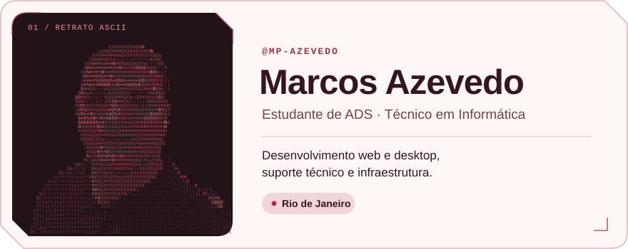

<picture>
  <source media="(prefers-color-scheme: dark)" srcset="./assets/profile-dark.svg">
  <source media="(prefers-color-scheme: light)" srcset="./assets/profile-light.svg">
  
</picture>

Sou estudante de Análise e Desenvolvimento de Sistemas e técnico em Informática, com experiência em suporte a usuários e redes. Nos meus projetos, exploro desenvolvimento web, bots para Discord e aplicações desktop com banco de dados.

## Habilidades

###  Desenvolvimento

`HTML` · `CSS` · `JavaScript` · `discord.js` · `C` · `C#` · `Windows Forms` · `PostgreSQL`

###  Suporte e sistemas

`Windows` · `Linux` · `Microsoft 365` · `Help Desk`

###  Redes e infraestrutura

`TCP/IP` · `DNS` · `Proxy` · `Cabeamento estruturado`

###  Design de interfaces

`Figma` · `Adobe Photoshop`

## Projeto em destaque

### Cadastro de produtos

Aplicação desktop para cadastrar, consultar, editar e excluir produtos. A interface usa Windows Forms, com acesso ao PostgreSQL via Npgsql.

`C#` · `Windows Forms` · `PostgreSQL`

[Ver o código do Cadastro de produtos](https://github.com/mp-azevedo/CSharp-WinForm-Crud)

<a href="https://github.com/mp-azevedo?tab=repositories">
  <picture>
    <source media="(prefers-color-scheme: dark)" srcset="./assets/repositorios-dark.svg">
    <source media="(prefers-color-scheme: light)" srcset="./assets/repositorios-light.svg">
    
  </picture>
</a>

## Experiência e formação

- **Estágio em TI · ETERJ** — Fev–jul de 2025. Suporte a usuários, manutenção de computadores e apoio à rede dos laboratórios.
- **Análise e Desenvolvimento de Sistemas · Unigranrio Afya** — Em andamento, com conclusão prevista para 2027.
- **Técnico em Informática · ETERJ** — Concluído em 2024.
