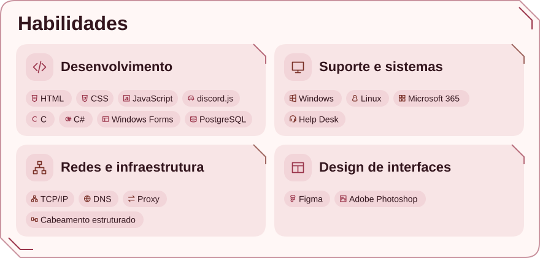
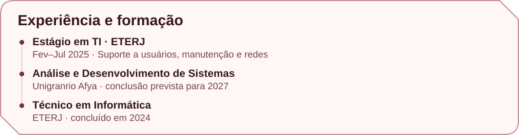

<picture>
  <source media="(prefers-color-scheme: dark)" srcset="./assets/profile-dark.svg">
  <source media="(prefers-color-scheme: light)" srcset="./assets/profile-light.svg">
  
</picture>

<!-- Habilidades -->
<picture>
  <source media="(prefers-color-scheme: dark)" srcset="./assets/habilidades-dark.svg">
  <source media="(prefers-color-scheme: light)" srcset="./assets/habilidades-light.svg">
  
</picture>

<!-- Experiência e formação -->
<picture>
  <source media="(prefers-color-scheme: dark)" srcset="./assets/trajetoria-dark.svg">
  <source media="(prefers-color-scheme: light)" srcset="./assets/trajetoria-light.svg">
  
</picture>

[Explorar meus repositórios →](https://github.com/mp-azevedo?tab=repositories)
